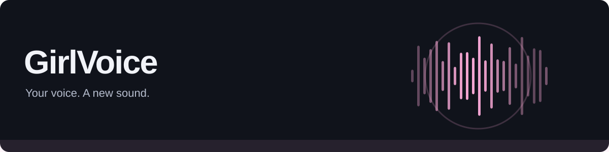

# GirlVoice

Verwandle deine Mikrofonaufnahme mit ElevenLabs und leite die Ausgabe an Kopfhörer oder ein virtuelles Mikrofon weiter. Für Windows und Linux.

[Einrichtung](#einrichtung-und-referenz) · [Quellcode](src/) · [Build-Workflow](.github/workflows/)

## Auf einen Blick

- **Direkte Sprachumwandlung.** Mikrofon → ElevenLabs Voice Changer → ausgewähltes Audiogerät.
- **Hören und steuern.** Stimmwahl, getrenntes Monitoring, sofortiger Ausgabestopp und lokale Verbrauchslimits.
- **Virtuelles Mikrofon.** Windows mit VB-CABLE; Linux mit PulseAudio oder PipeWire und `pactl`.

## Loslegen

Node.js 22 oder neuer. Aus dem Quellcode starten:

```sh
npm ci
npm start
```

Alternativ **start.bat** unter Windows oder **sh start.sh** unter Linux. Diese Startskripte bevorzugen ein vorhandenes Paket. In der App den eigenen ElevenLabs-Key hinterlegen, Mikrofon und Stimme wählen und zuerst mit Kopfhörern testen.

> **Gut zu wissen:** Sprache wird abschnittsweise an ElevenLabs übertragen. Netzwerk- und Modellverzögerung sind hörbar; API-Nutzung verbraucht Anbieter-Kontingent. Live-Audio und Linux müssen auf dem Zielsystem geprüft werden.

**Stack:** Electron · React · Vite · ElevenLabs

## Einrichtung und Referenz

<details>
<summary>Vollständige Anleitung: Audio-Routing, Datenschutz, Kosten und Builds</summary>

Eine Desktop-App für Windows und Linux mit direkter Sprachumwandlung: Mikrofon → ElevenLabs Voice Changer → ausgewähltes Audiogerät. Alternativ ist der bisherige Textmodus mit Scribe Realtime und Flash v2.5 verfügbar. Monitoring, Stimmwahl, sofortiger Ausgabestopp, lokale Verbrauchslimits und verschlüsselte Key-Speicherung.

## Start

Windows: **start.bat** doppelklicken. Linux: **sh start.sh** ausführen (oder einmal `chmod +x start.sh`, dann `./start.sh`). Die Skripte starten bevorzugt ein vorhandenes Paket aus `release`; ohne Paket installieren sie bei Bedarf die Projektabhängigkeiten und starten aus dem Quellcode. Zum Entwickeln neuer Änderungen ausdrücklich `npm start` verwenden, damit kein älteres Paket geöffnet wird.

Voraussetzung zur Entwicklung: Node.js 22 oder neuer.

```sh
npm ci
npm start
```

Die fertige Windows-App liegt nach `npm run pack:win` im Ordner `release`. Auf Linux erzeugt `npm run pack:linux` ein AppImage und ein tar.gz. Für die fertigen Apps ist Node.js nicht erforderlich. Linux-Pakete auf Linux bauen, Windows-Pakete auf Windows. Ein GitHub-Actions-Workflow baut beide Plattformen.

Das Linux-Archiv entpacken und im enthaltenen Ordner `sh start.sh` ausführen. Das beigefügte Skript setzt bei Bedarf die Ausführungsrechte. Ein auf Windows gepacktes Linux-Archiv ist ohne Laufzeittest unter Linux als Testversion zu betrachten.

## Einrichtung

1. Unter Einstellungen den eigenen ElevenLabs API-Key hinterlegen. Benötigte Rechte: Stimmen lesen und Voice Changer / Speech to Speech. Der optionale Textmodus braucht Text to Speech und Speech to Text. Zum Anzeigen des Kontingents zusätzlich Benutzerinformationen lesen. Eingeschränkte Leserechte für das Kontingent blockieren die Sprachfunktionen nicht.
2. Mit dem Aktualisieren-Knopf neben „Dein Setup“ den Mikrofonzugriff erlauben und Geräte laden. Der kurze Zugriff zur Geräteerkennung wird sofort beendet und nicht hochgeladen.
3. Eingabemikrofon, Ausgabe und Stimme wählen. Weiblich markierte Stimmen erscheinen zuerst. Die Liste des Kontos garantiert nicht, dass jede Stimme im Free-Tarif über die API nutzbar ist.
4. Zuerst Kopfhörer als Ausgabe wählen. Im Modus „Direkter Voice Changer“ auf „5 Sekunden aufnehmen & testen“ drücken und nach dem Aufnahmehinweis einen Satz sprechen. Danach wird das Mikrofon geschlossen und die Aufnahme umgewandelt. Der Test verbraucht Kontingent. „Ausgabe stoppen“ bricht Aufnahme und Wiedergabe ab. Bei Kopfhörern als Hauptausgabe Monitoring ausgeschaltet lassen.
5. Danach das virtuelle Ausgabegerät wählen, dieses in Discord oder im Spiel als Eingang einstellen und „Mikrofon starten“ drücken.

### Monitoring

Unter „Monitoring“ deine Kopfhörer wählen und „Mithören“ einschalten. Die erzeugte Stimme läuft gleichzeitig ins virtuelle Mikrofon und auf deine Kopfhörer. Der Lautstärkeregler verändert nur das Mithören, nicht die Discord-Ausgabe. Monitoring lässt sich auch während der Sitzung ein- und ausschalten. Es nutzt dieselbe erzeugte Audiospur und löst keine zusätzlichen ElevenLabs-Anfragen aus. Die Originalstimme wird nicht durchgereicht. Einstellungen werden gespeichert. Für getrennte Ausgaben zwei unterschiedliche Geräte auswählen; bei abgezogenen Kopfhörern wird nur Monitoring abgeschaltet.

### Direkter Voice Changer

Der direkte Modus ist vorausgewählt, auch beim ersten Start mit alten Einstellungen ohne Modus. Er nutzt `eleven_multilingual_sts_v2` mit PCM-Eingabe (16 kHz, mono, 16 Bit) und gestreamter PCM-Ausgabe (24 kHz). Deine Sprechweise dient als Vorlage; es gibt kein Transkript und keine parallelen Scribe- oder TTS-Anfragen.

Eine lokale Pegelerkennung sammelt Sprache in Abschnitten. Nach der gewählten Sprechpause oder spätestens nach 4 Sekunden wird der Abschnitt gesendet. Das ist abschnittsweise Umwandlung mit zusätzlicher Netzwerk- und Modellverzögerung, keine verzögerungsfreie Live-Verbindung. Durchgehende Sätze können an der Abschnittsgrenze hörbar unterbrochen werden. In ruhiger Umgebung und mit Kopfhörern sprechen; sehr leises Flüstern kann von der Pegelerkennung übergangen werden. Ein kurzer Vorlauf schützt Wortanfänge. Bei überfüllter Warteschlange stoppt die Sitzung sichtbar.

Unter Einstellungen begrenzt „Maximale Audiosekunden“ die eingereichten Aufnahmen pro direkter Sitzung (Standard: 180 Sekunden). Enthaltene Pausen und bereits abgeschickte, abgebrochene Anfragen zählen mit. Jeder Mikrofonstart und Aufnahmetest setzt diesen lokalen Zähler zurück. Er zeigt keine verbindlichen Provider-Credits oder Kosten. Für den bisherigen Weg im Setup „Sprache → Text → Stimme“ auswählen.

### Windows

[VB-CABLE](https://vb-audio.com/Cable/) installieren, gegebenenfalls neu starten. GirlVoice-Ausgabe: **CABLE Input**. Discord-Mikrofon: **CABLE Output**. Discord-Lautsprecher bleiben die normalen Kopfhörer. Das physische Mikrofon wird nicht in das Kabel durchgeschleift.

### Linux

Voraussetzung: PulseAudio oder PipeWire mit `pipewire-pulse`, sowie `pactl` (oft im Paket `pulseaudio-utils`). In Einstellungen auf **Virtuelles Mikrofon einrichten** klicken. Keine Root-Rechte nötig. GirlVoice-Ausgabe: **GirlVoice_Output**. Discord-Mikrofon: **GirlVoice_Microphone**. Falls die neuen Geräte nicht erscheinen, Geräte aktualisieren bzw. Discord neu öffnen.

Die App erzeugt einen Null-Sink und eine vom Monitor abgeleitete Mikrofonquelle. Sie entfernt beim normalen Beenden nur die Module, die sie selbst angelegt hat, und verändert keine Standardgeräte. Nach einem Absturz vorhandene Geräte werden wiederverwendet. Ein Audio-Server-Neustart entfernt temporäre Geräte; dann erneut einrichten. Nicht als Eingang das virtuelle Mikrofon wählen.

Für persistente Key-Speicherung wird ein sicherer System-Schlüsselbund benötigt, etwa GNOME Keyring oder KWallet. Ohne Schlüsselbund verweigert GirlVoice eine unverschlüsselte Speicherung und bietet nur Sitzungsspeicherung an. Bei AppImage-Problemen mit FUSE das tar.gz verwenden. Chromium-Sandbox nicht abschalten.

## Kosten und Grenzen

ElevenLabs bietet Free-Kontingente, aber API-Zugang, erlaubte Stimmen und Kontingente können vom Konto abhängen. Verbindlich ist das [eigene Dashboard](https://elevenlabs.io/app/settings/subscription), nicht die Zeichenanzeige dieser App. Keine automatische Buchung von Abos oder Guthaben. Bereits konfigurierte nutzungsabhängige Abrechnung beim Anbieter gilt auch für diese App.

- Nur im Textmodus überträgt Scribe während einer aktiven Sitzung auch Sprechpausen. Mikrofon stoppen beendet die Cloud-Verbindung. Im direkten Modus werden lokal erkannte Audioabschnitte übertragen.
- Das TTS-Zeichenlimit zählt angeforderte Zeichen, auch wenn eine Antwort abgebrochen wird. Es begrenzt nicht die Kosten der Spracherkennung. Ein neuer Mikrofonstart setzt den Sitzungszähler zurück. Stimmtests zählen mit.
- Die Kontingentanzeige zeigt Anbieterwerte zum Zeitpunkt der letzten Verbindungsaktualisierung. Diese können Credits oder Zeichen-Kontingente darstellen und sind kein Geldbetrag.
- Ausgabestopp verwirft wartende und laufende TTS-Ausgabe. Bereits übertragene Audiodaten in Discord lassen sich nicht zurückholen. Weitere bestätigte Sprachabschnitte werden wieder gesprochen. Mikrofon stoppen beendet alles.
- Im Textmodus werden erst bestätigte Transkripte gesprochen. Kurze Sprechpausen verbessern die Reaktionszeit. Tonfall, Lachen, Flüstern und Sarkasmus gehen beim Text-Zwischenschritt teilweise verloren. Der direkte Modus nutzt die Aufnahme als Vorlage, die tatsächliche Qualität hängt dennoch von Aufnahme und Zielstimme ab.
- Die Latenzanzeige schätzt Sprechbeginn bis lokal geplanter Audioausgabe. Sie enthält keine nachgelagerte Verzögerung durch den virtuellen Treiber oder Discord und ist keine garantierte End-to-End-Messung.
- Bei Netzwerkfehlern, Quotenfehlern und überfüllter Warteschlange stoppt die Sitzung, statt automatisch kostenpflichtige Anfragen zu wiederholen. Kein automatischer Wechsel auf die Originalstimme.
- Globales Push-to-Talk ist nicht enthalten.

## Datenschutz

API-Key im Electron-Hauptprozess, UI mit Context Isolation und Sandbox. Windows verwendet DPAPI über Electron safeStorage; Linux den verfügbaren Schlüsselbund. Keine Keys in Repository oder Browser-Storage. Einstellungen liegen im Benutzer-Datenverzeichnis von GirlVoice. Sprache wird direkt an ElevenLabs gesendet. Die App speichert keine Audio- oder Transkriptdateien; die Aufbewahrung durch ElevenLabs richtet sich nach dem Konto und den Anbieterbedingungen.

## Prüfen und bauen

```sh
npm test
npm run build
npm run test:desktop
npm run pack:win
```

`test:desktop` startet die echte App mit einem temporären Benutzerprofil, prüft UI, Einstellungen und AudioWorklet mit einem lokal erzeugten Testsignal. Er nutzt weder Mikrofon noch API-Key. Screenshots liegen außerhalb des Projekts im temporären Verzeichnis. `npm run dev` ist nur eine Browservorschau und bietet keinen Zugriff auf Desktop- oder Cloud-Funktionen.

API-Referenzen: [Voice Changer Streaming](https://elevenlabs.io/docs/api-reference/speech-to-speech/stream), [Scribe Realtime](https://elevenlabs.io/docs/api-reference/speech-to-text/v-1-speech-to-text-realtime), [TTS Streaming](https://elevenlabs.io/docs/api-reference/text-to-speech/stream), [Preise](https://elevenlabs.io/pricing/api).

</details>
